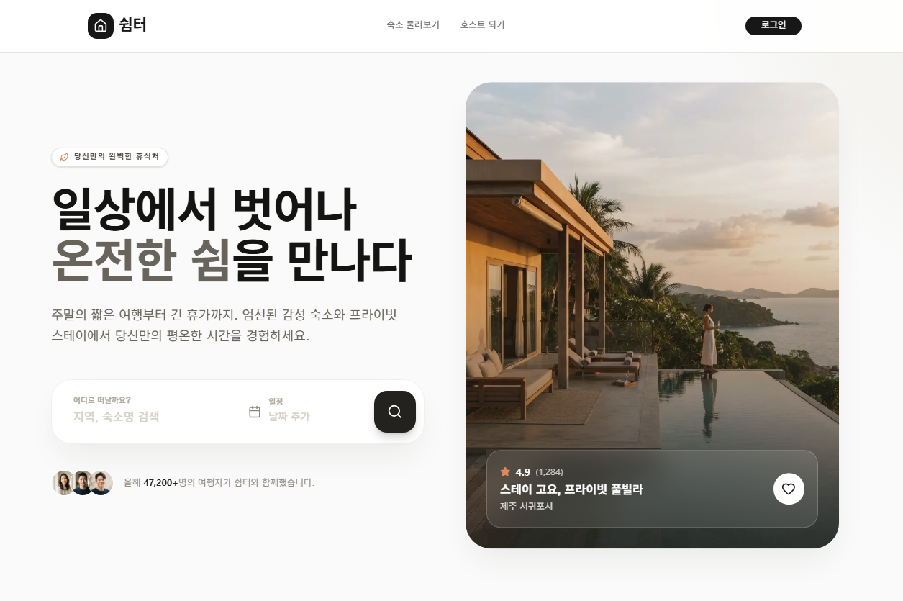
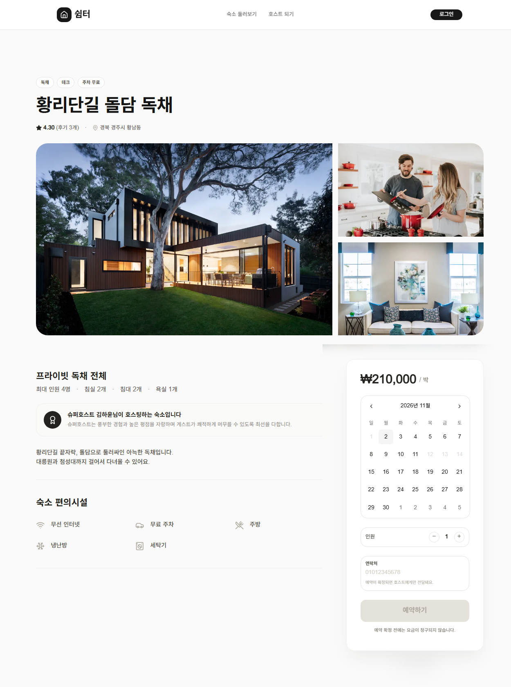
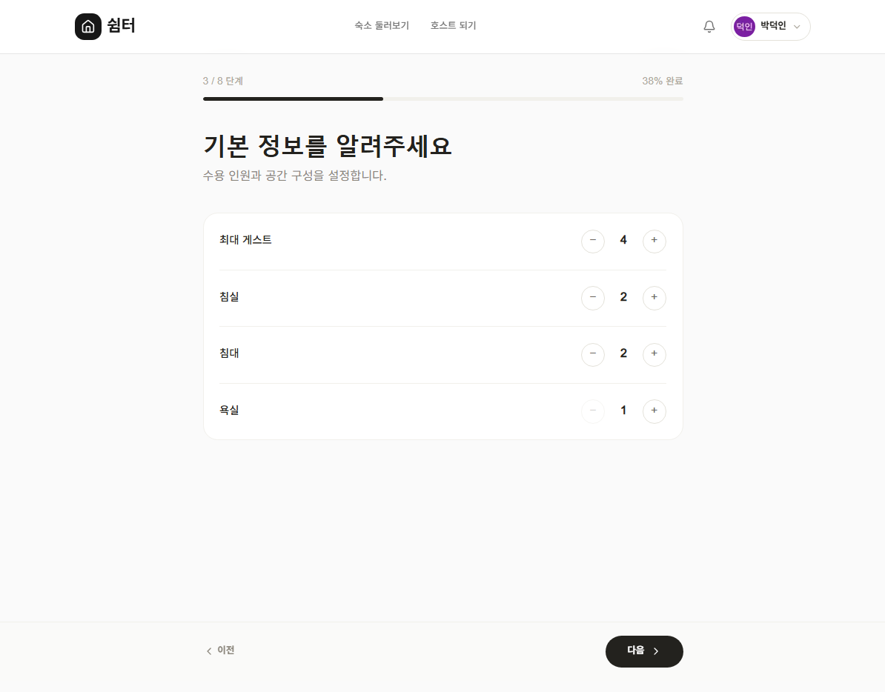

# 쉼터 (Simpyo)

> 개인 호스트와 여행자를 잇는 감성 숙소 예약 플랫폼


**[배포 사이트 바로가기](https://simpyo-peach.vercel.app)**

<p align="center">
  
</p>

<table>
  <tr>
    <td width="50%" valign="top">
      
      <p align="center">숙소 상세 · 예약된 날짜 비활성화</p>
    </td>
    <td width="50%" valign="top">
      
      <p align="center">8단계 숙소 등록 폼</p>
    </td>
  </tr>
</table>

<br />

## 소개

호스트가 숙소를 등록하고, 게스트가 날짜로 검색해 예약하는 Airbnb 형태의 숙소 예약 서비스입니다.

이 프로젝트에서 집중한 것은 세 가지입니다.

- **상태를 어디에 둘 것인가** — 서버 데이터, 폼 입력, 검색 조건, UI 상태를 성격에 맞는 곳에 나눠 관리
- **컴포넌트를 어떻게 나눌 것인가** — 상태를 모르는 UI 컴포넌트로 만들어 여러 화면에서 재사용
- **사용자가 기다리거나 헷갈리지 않게** — 낙관적 업데이트, 빈 상태, 동작하지 않는 버튼 없애기

<br />

## 주요 기능

### 게스트

| 기능      | 구현 포인트                                                                              |
| --------- | ---------------------------------------------------------------------------------------- |
| 숙소 검색 | 검색어 · 카테고리 · 정렬 · 날짜를 **URL 쿼리**로 관리해 새로고침 · 공유 시에도 같은 결과 |
| 날짜 필터 | 캘린더에서 두 번 클릭하는 동안은 임시 상태에 두고, "적용" 시 한 번만 URL 반영            |
| 숙소 상세 | 사진 수(1~3장)에 따라 그리드 레이아웃 변경, 카카오맵 지오코딩                            |
| 예약      | 예약된 날짜는 캘린더에서 비활성화, 성공 시 페이지 이동 없이 사이드바에서 확정 안내       |
| 찜하기    | **낙관적 업데이트** — 화면 먼저 반영 후 실패 시 롤백                                     |
| 리뷰      | 호버 미리보기가 있는 별점 입력, 최소 글자 수 검증                                        |
| 알림      | 안 읽은 개수는 1분 주기 갱신, 목록은 드롭다운을 열 때만 조회                             |

### 호스트

| 기능      | 구현 포인트                                                                     |
| --------- | ------------------------------------------------------------------------------- |
| 숙소 등록 | 8단계 멀티스텝 폼, 단계별 URL 분리로 **뒤로가기 · 새로고침에도 입력 유지**      |
| 숙소 수정 | 등록 폼의 단계 컴포넌트를 **한 화면에 재조립**, 기존 사진과 새 사진을 구분 표시 |
| 예약 관리 | 상태 탭별 개수 표시, 탭마다 정렬 방향 다르게 (예정은 가까운 순)                 |
| 숙소 삭제 | 확인 다이얼로그, 삭제 후 `router.refresh()`로 목록 갱신                         |

<br />

## 기술 스택

| 분류         | 기술                                 | 선택 이유                                                             |
| ------------ | ------------------------------------ | --------------------------------------------------------------------- |
| Framework    | Next.js 16 (App Router), TypeScript  | 서버 컴포넌트로 초기 데이터를 서버에서 조회해 로딩 깜빡임 감소        |
| Styling      | Tailwind CSS v4, shadcn/ui (Base UI) | 디자인 토큰 기반 일관된 스타일, 컴포넌트 코드를 직접 소유해 수정 가능 |
| Server State | TanStack Query                       | mutation의 로딩 · 에러 상태 관리, 쿼리 무효화로 관련 화면 동기화      |
| Client State | Zustand (persist)                    | 여러 페이지에 걸친 등록 폼 상태를 sessionStorage에 유지               |
| Backend      | Supabase (PostgreSQL, Auth, Storage) | 인증 · DB · 파일 저장을 하나로, RLS로 권한 관리                       |
| External     | Kakao Maps API                       | 주소 문자열을 좌표로 변환해 지도 표시                                 |
| Deploy       | Vercel                               |                                                                       |

<br />

## 아키텍처

[Feature-Sliced Design](https://feature-sliced.design/)을 적용해 레이어별 책임을 나눴습니다. 상위 레이어는 하위 레이어만 참조합니다.

```
app/        라우팅. 데이터를 조회해 위젯에 전달하는 얇은 계층
widgets/    여러 기능을 조합한 화면 단위 블록 (마이페이지, 숙소 상세)
features/   사용자 행동 단위 (숙소 등록, 예약, 찜, 리뷰 작성, 날짜 필터)
entities/   도메인 단위 데이터 · API · UI (accommodation, booking, review ...)
shared/     도메인을 모르는 공용 UI와 유틸 (DateRangePicker, 날짜 · 전화번호 유틸)
```

### 상태를 모르는 컴포넌트로 재사용하기

같은 원칙을 세 번 적용했습니다. **"보여주는 것"과 "데이터를 다루는 것"을 분리**하면 같은 컴포넌트를 다른 맥락에서 그대로 쓸 수 있습니다.

| 컴포넌트                                 | 받는 것                        | 재사용된 곳                                            |
| ---------------------------------------- | ------------------------------ | ------------------------------------------------------ |
| 등록 폼 단계 (`PropertyTypeStep` 등 7개) | `value`, `onChange`            | 등록 (Zustand) · 수정 (useState)                       |
| `StayCard`                               | `liked`, `onToggleLike`        | 숙소 목록 (찜 추가/해제) · 찜 목록 (해제 시 카드 제거) |
| `DateRangePicker`                        | `value`, `onChange`, `trigger` | 목록 필터 (URL 저장) · 메인 검색 (로컬 상태 저장)      |

`DateRangePicker`는 처음에 목록 필터 안에 URL 저장 로직과 함께 있었는데, 메인 검색에도 같은 캘린더가 필요해지면서 저장 방식만 밖으로 꺼내 공용 컴포넌트로 분리했습니다.

<br />

## 상태 관리 전략

상태를 성격에 따라 네 곳으로 나눴습니다.

| 상태                               | 위치                     | 이유                                                        |
| ---------------------------------- | ------------------------ | ----------------------------------------------------------- |
| 숙소 · 예약 등 서버 데이터         | 서버 컴포넌트에서 조회   | 첫 화면부터 데이터가 채워진 채로 렌더링                     |
| 예약 가능 날짜 · 알림              | TanStack Query           | 클라이언트에서 갱신이 필요하고, mutation 후 무효화로 동기화 |
| 검색 조건 (검색어, 카테고리, 날짜) | URL 쿼리                 | 새로고침 · 뒤로가기 · 링크 공유에도 유지                    |
| 등록 폼 (8단계)                    | Zustand + sessionStorage | 여러 페이지에 걸쳐 유지, 탭을 닫으면 자동 정리              |
| 수정 폼                            | useState                 | 한 페이지에서 끝나므로 전역 상태 불필요                     |

**등록 폼 persist에서 사진을 제외한 이유** — `File` 객체는 직렬화가 되지 않고 sessionStorage 용량도 작아, `partialize`로 사진만 저장 대상에서 뺐습니다.

### 서버 · 클라이언트 컴포넌트 경계

- 메인 히어로는 **서버 컴포넌트**로 두고, 입력을 받는 검색창만 클라이언트 컴포넌트로 분리
- 등록 레이아웃은 서버에서 로그인을 확인한 뒤, 진행률 · 이동 버튼만 클라이언트 컴포넌트에 `children`으로 전달
- 마이페이지처럼 여러 데이터가 필요한 페이지는 서로 의존하지 않는 조회를 `Promise.all`로 병렬 처리

<br />

## UX에서 신경 쓴 것

- **낙관적 업데이트** — 찜 버튼은 서버 응답을 기다리지 않고 바로 반영, 실패하면 되돌림. 반대로 예약처럼 실패 시 영향이 큰 작업은 로딩 상태를 보여주며 기다림
- **동작하지 않는 버튼은 두지 않기** — 기능이 없는 버튼은 제거하고, 조건이 안 맞는 버튼은 `disabled`로 이유를 시각적으로 표시
- **빈 상태** — 예약 · 찜 · 리뷰 · 검색 결과가 없을 때 다음 행동(숙소 둘러보기 등)을 안내
- **입력 편의** — 전화번호 입력 시 숫자 키패드(`inputMode="numeric"`), 하이픈 자동 제거, 표시할 때는 하이픈 추가
- **에러 메시지** — DB 에러 코드(중복 · 날짜 겹침 · 규칙 위반)를 사용자가 이해할 수 있는 문장으로 변환
- **한국어 캘린더** — `react-day-picker`에 `ko` locale을 기본값으로 지정

<br />

## 트러블슈팅

<details>
<summary><b>선택한 예약 날짜가 하루씩 앞당겨져 저장됨</b></summary>

- **문제** — 캘린더에서 15일을 골랐는데 14일이 저장됨
- **원인** — `Date.toISOString()`은 UTC 기준이라, 한국 자정(KST 00:00)이 UTC로는 전날 15:00이 됨
- **해결** — `getFullYear()` · `getMonth()` · `getDate()`로 로컬 날짜를 직접 조합하는 `toDateKey`, 반대 방향의 `parseDateKey` 유틸을 만들어 날짜 변환을 한곳으로 통일

</details>

<details>
<summary><b>클라이언트 레이아웃 안에서 서버 컴포넌트를 쓰려다 에러</b></summary>

- **문제** — `'use client'` 레이아웃에서 서버에서 유저를 조회하는 헤더를 import하자 에러
- **원인** — 클라이언트 컴포넌트는 서버 컴포넌트를 직접 import할 수 없음
- **해결** — 레이아웃은 서버 컴포넌트로 되돌리고, 상호작용이 필요한 부분만 클라이언트 컴포넌트로 분리해 `children`으로 서버 렌더링 결과를 전달

</details>

<details>
<summary><b>드롭다운이 다른 섹션 뒤로 잘려 보임</b></summary>

- **문제** — 알림 드롭다운과 날짜 캘린더가 `z-index`를 높여도 잘림
- **원인 1** — 부모 섹션의 `overflow-hidden`이 경계 밖 내용을 잘라냄
- **원인 2** — 필터 바의 `backdrop-filter`가 `position: fixed`의 기준을 바꿔, 화면 전체를 덮는 투명 레이어로 바깥 클릭을 감지하는 방식이 동작하지 않음
- **해결** — 장식용 배경이 가로로 넘치는 것만 막도록 `overflow-x-clip`으로 변경, 바깥 클릭은 `document` 이벤트와 `ref.contains()`로 감지

</details>

<details>
<summary><b>카드 안의 버튼을 누르면 페이지 이동까지 함께 발생</b></summary>

- **문제** — 카드 전체를 `Link`로 감싸자, 찜 · 삭제 버튼을 눌러도 상세 페이지로 이동
- **원인** — 클릭 이벤트가 부모 `Link`로 전파됨. 링크 안에 버튼을 중첩하는 구조 자체도 HTML상 올바르지 않음
- **해결** — 찜 버튼은 `preventDefault` · `stopPropagation`으로 전파 차단, 버튼이 여러 개인 관리 카드는 클릭 영역과 버튼 영역을 형제로 분리

</details>

<details>
<summary><b>effect 안의 setState 경고</b></summary>

- **문제** — 완료 페이지에서 중복 제출을 막으려고 `useEffect` 안에서 `setState`를 호출하자 연쇄 렌더링 경고
- **원인** — 화면에 영향이 없는 "이미 제출했는지" 플래그를 렌더링용 상태로 관리함
- **해결** — 리렌더링을 일으키지 않는 `useRef`로 변경

</details>

<details>
<summary><b>화면에서 막았는데 실제로는 막히지 않음</b></summary>

- **문제** — 예약 금액을 브라우저에서 계산해 보내, 개발자 도구로 요청을 수정하면 금액 조작이 가능. 화면에 표시하지 않는 호스트 전화번호도 페이지 소스에 포함됨
- **원인** — 화면에서 숨기거나 입력칸을 두지 않는 것은 보안이 아니라 표현의 문제
- **해결** — 금액은 DB 트리거가 재계산하고, 조회 시 `select *` 대신 공개 컬럼만 명시적으로 가져오도록 변경. 이후 "사용자가 이 값을 바꿔 보내면?"을 기능마다 확인하는 습관을 들임

</details>

<br />

## 개발 방식 · AI 활용

| 도구         | 사용 범위                    |
| ------------ | ---------------------------- |
| v0, Supanova | 페이지 디자인 시안 생성      |
| Claude       | 설계 논의, 디버깅, 코드 리뷰 |

AI가 만든 결과물은 그대로 쓰지 않고 프로젝트 구조에 맞게 다시 다듬었습니다.

- **디자인 시안 → 컴포넌트화** — v0로 만든 마이페이지 시안은 페이지 하나에 모든 마크업이 있는 형태였습니다. 이를 FSD 레이어에 맞춰 위젯으로 나누고, 하드코딩된 목업을 실제 데이터로 교체하고, 동작하지 않는 버튼을 정리했습니다
- **제안을 검증하고 고르기** — 수정 기능은 "등록 단계 재사용"과 "단일 수정 페이지" 두 방식을 비교한 뒤, 실제 서비스들의 패턴과 부분 수정이 많은 사용 흐름을 근거로 후자를 선택했습니다
- **직접 잡아낸 문제** — 요일 배열 오타, 같은 목적지로 가는 중복 버튼, 실존하지 않는 더미 주소로 인한 지도 오류 등은 결과를 직접 확인하며 발견했습니다

<br />

## 시작하기

```bash
# .env.local
NEXT_PUBLIC_SUPABASE_URL=
NEXT_PUBLIC_SUPABASE_ANON_KEY=
NEXT_PUBLIC_KAKAO_MAP_KEY=
```

```bash
npm install
npm run dev
```

DB 스키마는 `supabase/migrations`의 SQL을 번호 순서대로 실행합니다. Google OAuth, Storage 버킷(`listing-images`), 카카오 JS SDK 도메인 설정이 추가로 필요합니다.

<br />

## 향후 계획

- [ ] 사진 전체 보기 모달
- [ ] 로딩 스켈레톤 UI
- [ ] 키보드 접근성 개선 (드롭다운 · 캘린더 포커스 관리)
- [ ] 컴포넌트 · E2E 테스트 (Vitest, Playwright)
- [ ] 리뷰 수정 · 삭제
- [ ] Supabase Realtime 기반 실시간 알림
